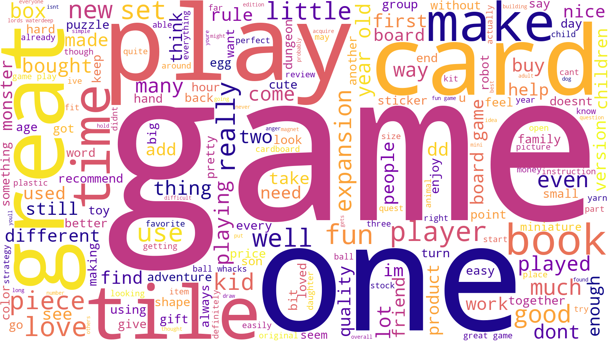

# Customer Behaviour & Sentiment Analysis: Turtle Games

> 🏅 **Awarded Distinction.** This was the final assignment for *Advanced Analytics for Organisational Impact (DA301)*, Course 3 of the LSE Data Analytics Career Accelerator.

## The business problem

Turtle Games, a game manufacturer and retailer in the course scenario, wanted to understand how customers build up loyalty points, which customer groups to target, and what customers think of its products. I analysed 2,000 customer records and their written reviews, and recommended how to improve marketing and the loyalty programme.

## Key findings

- **Spending score is the strongest predictor of loyalty points.** In simple regressions it explains 45% of the variation (R² = 0.452), against 38% for remuneration (R² = 0.380) and almost nothing for age (R² = 0.002).
- **A multiple linear regression in R explains about 84% of the variation** in loyalty points using age, remuneration and spending score. Product type was not significant and was removed.
- **A decision tree confirmed the result.** Spending score is the first split. The unpruned tree scored R² = 0.995 on unseen data and a pruned tree (depth 4) scored 0.944, trading a little accuracy for a model that non-technical stakeholders can read.
- **Five customer segments** came out of K-means clustering on remuneration and spending score, chosen using the elbow and silhouette methods. Segment sizes range from 269 to 774 customers. Customers with similar incomes often spend very differently, so behaviour is a better basis for targeting than income. Six clusters produced a small 118-customer group, which suggested over-segmentation.
- **Reviews are mostly positive.** Frequent words include "game" (the most common, with 1,359 mentions), "play", "fun" and "great", pointing to enjoyable gameplay and educational value. Complaints focus on poor quality, incomplete components and confusing instructions, not the games themselves.

## Recommendations

1. Base marketing on **customer behaviour, not demographics**: reward customers with high spending scores with personalised incentives.
2. Use the **five segments** to tailor campaigns instead of treating all customers the same.
3. Fix the **recurring product complaints** (quality, missing pieces, unclear instructions) and keep monitoring reviews to track satisfaction.

## Project files

- 📓 [Python notebook](analysis-notebook.ipynb): regression, decision trees, K-means clustering and NLP
- 📊 [R script](analysis-script.R): exploratory analysis and multiple linear regression
- 📄 [Technical report](technical-report.pdf): findings and recommendations (6 pages)
- 🎥 [Presentation video](https://youtu.be/q0dLZbWfBGA): a walkthrough for business stakeholders (just over 9 minutes)

## Methods and tools

| Area | Techniques | Tools |
|---|---|---|
| Regression | Simple and multiple linear regression, goodness-of-fit checks, diagnostics | statsmodels, scikit-learn, R (`lm`) |
| Decision trees | Regression tree, pruning, train/test comparison | scikit-learn |
| Clustering | K-means, elbow and silhouette methods | scikit-learn, seaborn |
| Text analysis | Tokenisation, stop-word removal, word clouds, polarity and subjectivity | NLTK, TextBlob, WordCloud |
| Exploratory analysis | Distributions, correlation, boxplots, normality tests | R (tidyverse, skimr, moments, psych) |

## Note on the data

The dataset (`turtle_reviews.csv`) is provided as part of the LSE course and is not included here, so the notebook and script will not re-run without it. The charts and results are saved in the notebook, so you can read it without the data.

## About me

I'm Dagmara, an operations professional moving into data and reporting analysis. [Connect on LinkedIn](https://www.linkedin.com/in/dagmara-gauden-180771111) or see my [GitHub profile](https://github.com/dagg92).
